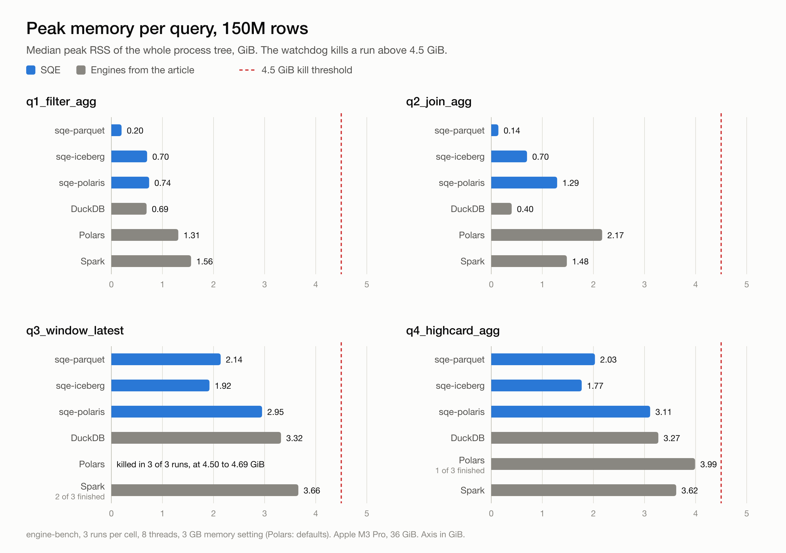
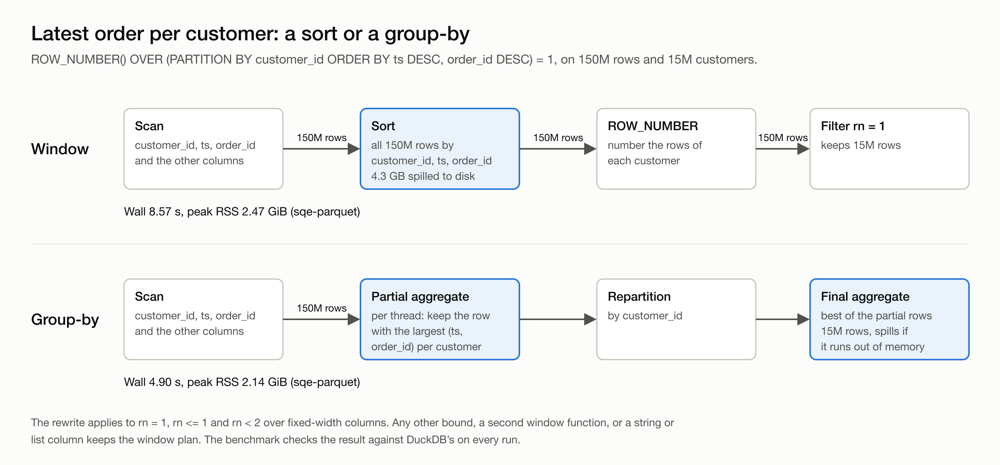
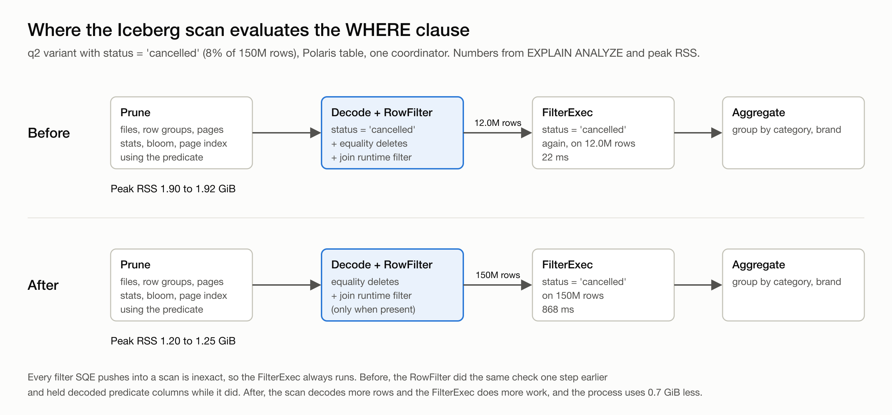

Firat Celik's [DuckDB 2.0 vs Polars vs Spark on one machine: 150M rows under a 4.5 GiB cap](https://dev.to/firfircelik/duckdb-20-vs-polars-vs-spark-on-one-machine-150m-rows-under-a-45-gib-cap-h38) asks a question most data teams run into: which engine still finishes when memory is tight. Firat ran four queries a data engineer writes every week over 150M rows, with a fresh process per run and a watchdog that kills any engine whose process tree goes above 4.5 GiB. The scripts are public in [engine-bench](https://github.com/firfircelik/engine-bench), with pinned versions and a seeded data generator. Anyone can rerun them.

We did, with SQE added. SQE is our SQL engine for Apache Iceberg, built on Apache DataFusion. We wanted to see where it stands on a workload we did not design, and to learn from whatever broke. The upstream queries, data and runners stay unchanged, at the article's versions: DuckDB 2.0.0, Polars 2.0.0 and PySpark 4.2.0. Every engine's answer is checked against DuckDB's, and all of them match.

Our results table says SQE takes about half DuckDB's time on the two heavy queries. One of those leads held up. The other came from a busy laptop. Below is how we told them apart, how the article's findings look on our machine, and the two problems the benchmark found in SQE.

## The setup

The workload is a star schema: a `sales` fact table of 150M rows (3.2 GB of Parquet in 30 files, about 15M customers) and a 50,000-row `products` dimension. The four queries:

| Query | What it does |
|---|---|
| `q1_filter_agg` | Filter on a timestamp and a status, group by store and status |
| `q2_join_agg` | Join the fact to the dimension, drop cancelled orders (`status <> 'cancelled'`), group by category and brand |
| `q3_window_latest` | Latest order per customer: `ROW_NUMBER() OVER (PARTITION BY customer_id ORDER BY ts DESC, order_id DESC) = 1` |
| `q4_highcard_agg` | One row per customer, about 15M groups |

SQE runs in three modes:

| Engine | What runs | Where the data is |
|---|---|---|
| `sqe-parquet` | `sqe-cli --embedded`, a view over `read_parquet()` | The same Parquet files DuckDB and Polars read. The like-for-like row. |
| `sqe-iceberg` | `sqe-cli --embedded --warehouse` | A local Iceberg warehouse, loaded once with CTAS |
| `sqe-polaris` | A native `sqe-server` coordinator, queried over Arrow Flight SQL (ADBC) | Iceberg tables in Polaris, data in RustFS (S3) in Docker |

The rules follow the article. Every engine gets 8 threads. DuckDB, Spark and SQE get a 3 GB memory setting; Polars has no such setting and runs with its defaults, as in the article. Each run is a fresh process. A run waits until the machine has 5 GiB free and is under 30% CPU, and the engine order rotates per repetition. The watchdog samples the RSS of the whole process tree every 50 ms and kills the run above 4.5 GiB. We report medians of 3 repetitions.

The machine is different. The article used an 8 vCPU Xeon VM with 15 GiB of RAM. We ran on an Apple M3 Pro laptop with 36 GiB. The thread count and the kill threshold are the same, so the memory picture carries over; absolute times do not.

## Query time

Median seconds to read, compute and write the answer. Lower is better.

| Query | `sqe-parquet` | `sqe-iceberg` | `sqe-polaris` | DuckDB | Polars | Spark |
|---|---:|---:|---:|---:|---:|---:|
| `q1_filter_agg` | 0.61 | 0.75 | 7.17 | 0.68 | **0.58** | 5.45 |
| `q2_join_agg` | **1.06** | 1.14 | 4.97 | 1.38 | 1.14 | 10.02 |
| `q3_window_latest` | **4.72** | 6.57 | 13.91 | 9.03 | killed | 30.91 |
| `q4_highcard_agg` | **4.11** | 5.58 | 13.79 | 8.26 | 4.17 | 30.90 |
| geomean | **1.88** | 2.36 | 9.10 | 2.89 | - | 15.11 |

Polars wins the filter by 30 ms. SQE on Parquet has the lowest median on the other three queries. All three SQE modes and DuckDB finish every run of every query; Polars and Spark do not.

Those medians flatter SQE on the two heavy queries, so we checked both gaps before writing them down. We ran SQE and DuckDB alone, alternating, and measured CPU time and busy cores next to wall time.

On the window query the gap is noise. Alone, SQE took 4.8 to 4.9 s and DuckDB 4.4 to 5.1 s. The 9.03 s median above came from runs with less free memory on the laptop. DuckDB spills 2.9 GB on this query and SQE 1.4 GB, so DuckDB loses more when the spill files no longer fit in the page cache.

On the group-by the gap is real, and it comes from memory. Both engines spend about 30 CPU seconds on q4. What differs is how many cores each one keeps busy under the cap.

The query has 15M groups in 150M rows, so almost every row starts a new group. Pre-aggregating such rows saves nothing, and DataFusion's partial aggregate notices that after the first batches: it passed 149.1M of the 150M rows straight through. The rows are then hash-partitioned by `customer_id` to 8 final aggregates, so each group is held once. SQE stays near 2 GiB at any memory setting.

DuckDB needs 10 to 11 GiB for the same query without a limit, and then the two engines are level: 3.0 to 3.2 s against SQE's 3.3 to 3.5 s. Under the 3 GB setting DuckDB spills about 6 GB and keeps 4 to 5 cores busy where SQE keeps 7.5. That costs it 5 to 8 s. The credit belongs to DataFusion's aggregate. A memory cap is exactly what the article tests, so the result counts. Give DuckDB the memory it asks for and the two finish together.

## Memory

Median peak RSS of the whole process tree, in GiB. The cap is 4.5.



| Query | `sqe-parquet` | `sqe-iceberg` | `sqe-polaris` | DuckDB | Polars | Spark |
|---|---:|---:|---:|---:|---:|---:|
| `q1_filter_agg` | 0.20 | 0.70 | 0.74 | 0.69 | 1.31 | 1.56 |
| `q2_join_agg` | 0.14 | 0.70 | 1.29 | 0.40 | 2.17 | 1.48 |
| `q3_window_latest` | 2.14 | 1.92 | 2.95 | 3.32 | killed | 3.66 |
| `q4_highcard_agg` | 2.03 | 1.77 | 3.11 | 3.27 | 3.99 | 3.62 |

Finished runs out of three:

| Query | `sqe-parquet` | `sqe-iceberg` | `sqe-polaris` | DuckDB | Polars | Spark |
|---|---:|---:|---:|---:|---:|---:|
| `q3_window_latest` | 3/3 | 3/3 | 3/3 | 3/3 | 0/3 | 2/3 |
| `q4_highcard_agg` | 3/3 | 3/3 | 3/3 | 3/3 | 1/3 | 3/3 |

Every other cell is 3/3.

The three engines from the article behave here the way the article says they do. "Polars is not slow," as the article puts it, and it is fast when it fits, but it is killed on the window query in all three runs, at 4.50 to 4.69 GiB. It finishes the high-cardinality group-by once in three. Spark's query time is three to eight times DuckDB's, in line with the article's 4.3x to 7.9x, and it loses one window run in three. The article lost it to the watchdog at 7.51 GiB and noted that "`spark.driver.memory = 3g` did not keep the process at 3 GiB." We lost it inside the JVM, to a `SparkOutOfMemoryError` (`UNABLE_TO_ACQUIRE_MEMORY`) at 3.53 GiB. DuckDB finishes everything, with the window and group-by queries at 3.3 GiB.

SQE on Parquet stays at 2.0 to 2.1 GiB on the two heavy queries and under 0.25 GiB on the two light ones. The filter and the join aggregate as the rows stream past, and the aggregate state is small, so the 3 GB limit is never close.

## Next to the article's numbers

Our machine is not the article's, so the first check is whether the three engines keep their shape. The article reports wall seconds, the whole process from start to exit, so this table does too. It is a different measure from the query-time table above.

| Query | DuckDB, article | DuckDB, here | Polars, article | Polars, here | Spark, article | Spark, here |
|---|---:|---:|---:|---:|---:|---:|
| `q1_filter_agg` | 0.87 | 0.97 | 0.96 | 0.89 | 10.77 | 10.52 |
| `q2_join_agg` | 1.47 | 1.68 | 1.46 | 1.50 | 16.10 | 15.10 |
| `q3_window_latest` | 7.92 | 9.93 | killed | killed | 46.29 (2/3) | 37.11 (2/3) |
| `q4_highcard_agg` | 7.91 | 8.62 | 4.21 (1/3) | 4.50 (1/3) | 39.70 | 36.08 |

A fraction such as (2/3) counts the finished runs where not every run finished. The three engines keep their shape. The light queries land within 15% of the article's times. On the heavy ones DuckDB is 9 to 25% slower here and Spark 9 to 20% faster. Polars fails on the same query in the same way. Memory moves even less: DuckDB peaks at 3.0 GiB on the heavy queries there and 3.3 GiB here.

The article went further than the four-query run, and two of its follow-ups belong next to our numbers. Polars 2.0.0 with a 3 GiB out-of-core budget (`POLARS_OOC_MEMORY_BUDGET_MB=3072`) was still killed on the window query, and with the cap raised to 9 GiB it was killed at 9.04 to 9.54 GiB. Polars 2.1.0 finished it with a budget: 18.78 s at 3.34 GiB with 3072 MB, 20.11 s at 1.29 GiB with 1024 MB. The article's max-timestamp rewrite of the query ran in 5.12 s on Polars. DuckDB with `memory_limit=1GB` finished the window query in 14.97 s at 1.12 GiB and the group-by in 13.94 s at 1.08 GiB. We have not run SQE at 1 GB yet.

The article's verdict on Polars holds for any engine: "Fast and close to the edge is a fine place for a notebook and a bad place for a scheduled job." Polars on the group-by shows why, peaking at 4.0 GiB and finishing one run in three. We hold SQE to the same bar, so we watch peak memory as closely as time.

## What the benchmark found in SQE

Our first full run did not look like the tables above. SQE was slow on the window query, and its Iceberg scan used more memory than it needed. We traced both, and both are now fixed in SQE. A benchmark someone else wrote finds the cases you did not think to test.

### The window query sorted 150M rows to keep 15M

`ROW_NUMBER() ... = 1` asks for one row per customer. DataFusion 55 plans it as written: sort the whole input by customer, timestamp and order id, number the rows, keep row one. For q3 the sort is the whole query. In an earlier `EXPLAIN ANALYZE` trace it spilled 4.3 GB to disk, only for nine rows in ten to be thrown away at the end. DataFusion has a `WindowTopN` rewrite, but it does not match `rn = 1`, and the rework that would make it match lands after version 55.



The article worked around the same query on Polars by hand, with a max-timestamp rewrite. SQE now does that rewrite in the planner, so nobody has to write it by hand. A logical rule turns the filter over the window into a group-by on the partition key.

For each customer the aggregate keeps the best row seen so far. Its sort key is stored in Arrow's row format, so comparing a new row with the current best is one byte comparison. Because the rule runs inside DataFusion's hash aggregate, it gets the partial and final stages, memory accounting and spilling that every group-by has.

The rewrite applies only when the result stays the same: `rn = 1`, `rn <= 1` or `rn < 2`, one window function, and fixed-width columns. Another bound, a second window function in the same node, or a string or list column keeps the window plan. Among rows that tie on every `ORDER BY` key the first one seen wins, which is as arbitrary as the window's own choice.

On Parquet, q3 wall time went from 8.57 s to 4.90 s and peak memory from 2.47 to 2.14 GiB. The rewrite brought SQE level with DuckDB on the window query.

### The Iceberg scan checked every kept row twice

A `WHERE` clause that reaches an Iceberg scan can do work at three levels. It can skip whole files from the manifest statistics. It can skip row groups and pages inside a file, using column statistics, bloom filters and the page index. And it can become a Parquet `RowFilter`: the reader decodes the predicate columns first, evaluates the predicate on every row, and decodes the other columns only for the rows that pass. The iceberg-rust reader did all three with the scan predicate.

SQE also keeps a `FilterExec` above every scan. DataFusion removes that filter only when the scan promises an exact result, and SQE's scans never promise it, so every pushed filter is marked inexact. Every row the `RowFilter` kept was checked a second time above it.



Checking each row twice costs little CPU. The real cost was memory. When the Parquet reader in arrow-rs runs a `RowFilter`, it caches the predicate columns it decoded, so it need not decode them again for the output. It caches only columns that are also in the output, and here they always were: the `FilterExec` above needs `status` to check it again. The cache defaults to 100 MB per row group, the Iceberg path does not change that default, and the scan decodes about one file per core at a time. We have not profiled the cache on its own. What we measured is the result of turning the `RowFilter` off, on the 150M-row Polaris table with one coordinator and a fresh server per run:

| Predicate | Rows kept | Peak RSS with `RowFilter` | without |
|---|---:|---:|---:|
| q2, `status <> 'cancelled'` | 92% | 1.98 / 2.04 GiB | 1.26 / 1.26 GiB |
| q2, `status = 'cancelled'` | 8% | 1.92 / 1.90 GiB | 1.25 / 1.20 GiB |
| q1, `ts >= ... AND status IN (...)` | not counted | 1.35 / 1.44 GiB | 0.64 / 0.69 GiB |

Two repetitions each, side by side. Memory rose by 55 to 110%, whether the predicate kept most rows or few.

The 8% query is the case where the `RowFilter` should win. With it, the scan hands 12.0M rows to the `FilterExec`, which spends 22 ms on them. Without it, the scan hands over all 150M rows and the `FilterExec` spends 868 ms. Spread over 8 threads, that extra filter work did not show up in the query time: without the `RowFilter` the query was as fast or faster in every run.

So the scan predicate still prunes files, row groups and pages. It is no longer a per-row `RowFilter`, and the `FilterExec` drops the rest. DataFusion's own Parquet reader splits the work the same way with its default `pushdown_filters = false`. Two things stay in the `RowFilter`. Equality deletes must be applied in the scan, because no operator above it can see the delete files. Join runtime filters arrive while the scan runs and cut rows of the fact table before they reach the join. The benchmark queries before and after, both from this machine:

| Query | Engine | Peak RSS before | after |
|---|---|---:|---:|
| `q1_filter_agg` | `sqe-iceberg` | 1.08 GiB | 0.70 GiB |
| `q2_join_agg` | `sqe-iceberg` | 1.48 GiB | 0.70 GiB |
| `q1_filter_agg` | `sqe-polaris` | 1.48 GiB | 0.74 GiB |
| `q2_join_agg` | `sqe-polaris` | 1.97 GiB | 1.29 GiB |

`scan_static_row_filter = true` in a catalog's section brings the old behaviour back. We kept the switch for very selective predicates on wide rows, where decoding fewer rows could still pay off. We have not measured such a case yet. Distributed workers read Parquet through their own reader, which builds a `RowFilter` only when a late-materialization check says it pays. The change does not touch them, and they are the next thing we measure.

## Why Polaris is slower

The `sqe-polaris` column runs the same engine through a different path. The other engines read Parquet from local disk. `sqe-polaris` reads Iceberg data from RustFS in Docker, and on macOS every byte from a container crosses the Docker Desktop port forward, which moves about 220 MB/s here. The time also includes a catalog round trip, an Arrow Flight SQL fetch and the client writing the result.

The harness can put every engine on the same path. `STORAGE=s3` copies the Parquet into RustFS and points DuckDB, Polars, Spark and `sqe-parquet` at `s3://`. In that mode, measured on 2 November before both fixes, the gap closes. Median q1 query time was 8.0 s on DuckDB, 7.4 s on Polars, 7.6 s on `sqe-parquet` and 9.4 s on `sqe-polaris`. The port forward is the bottleneck for everyone. The Polaris path is still the one SQE is built for: a catalog, a policy-checked plan and the user's own credentials.

## Run it yourself

The harness is in `quickstart/engine-bench/`. It clones engine-bench at a pinned commit, generates the data, loads the Iceberg copies, runs every engine, validates the answers against DuckDB's and writes the tables above.

```bash
make bench                                # 150M rows, 3 reps, all engines + Spark (about an hour)
make bench BENCH_STORAGE=s3               # every engine reads from RustFS
make bench-smoke                          # 10M rows, no Spark, fails on any mismatch
```

The article ends with "If your job fits on one machine, measure it on one machine before you start a cluster for it." We agree. The harness also checks every answer, and that check carried our two fixes: both changed how a query runs, and the proof they kept the result is that all 24 cells still match DuckDB's.

Thanks to Firat for publishing the scripts and the raw numbers. Next on our list are SQE at the article's 1 GB setting and larger data, published the same way.
