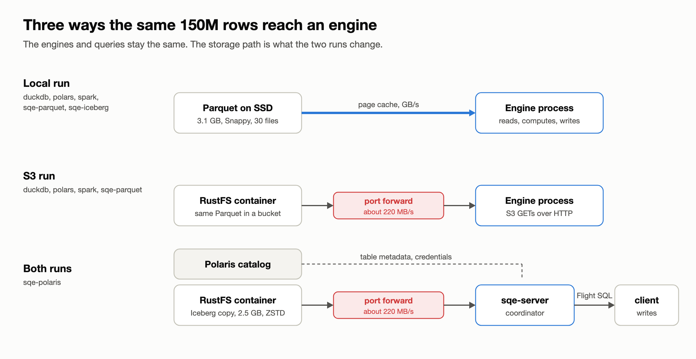
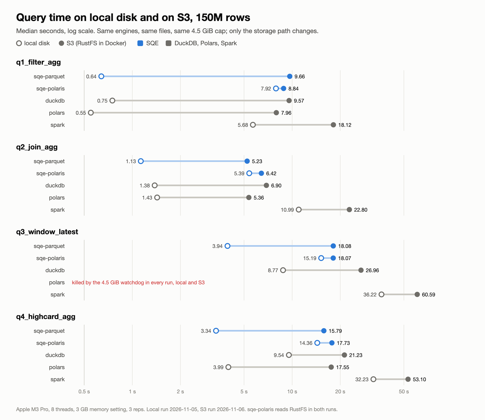
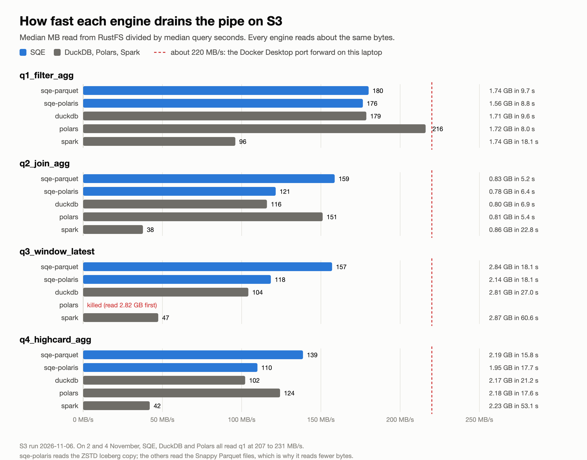

In [150M rows under a 4.5 GiB cap](./2026-11-02-150m-rows-under-a-4-5-gib-cap.md) we reran Firat Celik's [engine-bench](https://github.com/firfircelik/engine-bench) workload with SQE added. Most of that post reads Parquet from local disk. One section reads it from S3. On 5 and 6 November we ran both modes again, back to back, on the same laptop. SQE is our SQL engine for Apache Iceberg, built on Apache DataFusion.

The two runs do not tell the same story. On local disk SQE has the lowest geomean by a wide margin, 0.6x DuckDB's. On S3 the lead shrinks to 0.8x, Polars draws level with SQE on the three queries it finishes, and the light queries become a coin toss. Nothing about the engines changed between the runs. The storage path did.

Every answer in both runs matches DuckDB's. Polars is again killed on the window query in every run.

## Two runs, three paths



The workload is the one from the earlier post: a 150M-row `sales` fact table in 30 Parquet files, a 50,000-row `products` dimension, and four queries. Every engine gets 8 threads and a 3 GB memory setting. Each run is a fresh process, a watchdog kills any run above 4.5 GiB, and a run starts only when the laptop is under 30% CPU. We report medians of 3 repetitions.

In the local run, the engines read the Parquet files from the laptop's SSD. The files are 3.1 GB and the machine has 36 GiB, so after the first read they come from the page cache. In the S3 run, `STORAGE=s3` copies the same files into a RustFS bucket in Docker and points DuckDB, Polars, Spark and `sqe-parquet` at `s3://`. On macOS every byte from a container crosses the Docker Desktop port forward, which moves about 220 MB/s on this machine.

`sqe-polaris` is different. It reads Iceberg tables through the Polaris catalog, with the data in RustFS, in both runs. Its path does not change between the two days, which makes it our control.

## The numbers

Median query time in seconds, the fastest per query in bold. Local disk, 5 November:

| Query | `sqe-parquet` | `sqe-polaris` | DuckDB | Polars | Spark |
|---|---:|---:|---:|---:|---:|
| `q1_filter_agg` | 0.64 | 7.92 | 0.75 | **0.55** | 5.68 |
| `q2_join_agg` | **1.13** | 5.39 | 1.38 | 1.43 | 10.99 |
| `q3_window_latest` | **3.94** | 15.19 | 8.77 | killed | 36.22 |
| `q4_highcard_agg` | **3.34** | 14.36 | 9.54 | 3.99 | 32.23 |
| geomean | **1.76** | 9.82 | 3.05 | - | 16.43 |

S3, 6 November:

| Query | `sqe-parquet` | `sqe-polaris` | DuckDB | Polars | Spark |
|---|---:|---:|---:|---:|---:|
| `q1_filter_agg` | 9.66 | 8.84 | 9.57 | **7.96** | 18.12 |
| `q2_join_agg` | **5.23** | 6.42 | 6.90 | 5.36 | 22.80 |
| `q3_window_latest` | 18.08 | **18.07** | 26.96 | killed | 60.59 |
| `q4_highcard_agg` | **15.79** | 17.73 | 21.23 | 17.55 | 53.10 |
| geomean | **10.96** | 11.61 | 13.95 | - | 33.95 |



The chart shows the shape. Locally, the fast engines spread out: on the window query DuckDB takes 2.2 times as long as SQE. On S3 they bunch up. `sqe-polaris` barely moves, because it was reading from RustFS all along. Spark stays far to the right in both runs.

The geomean hides Polars, since it has no window-query time. Over the other three queries, Polars is at 1.46 s locally against `sqe-parquet`'s 1.34 s, 9% behind. On S3 it is at 9.08 s against 9.27 s, which is level.

## Every engine waits on the same pipe

All five engines read nearly the same bytes. Each one reads only the columns a query needs, and the files are the same, so q1 costs every engine about 1.7 GB from RustFS and q3 about 2.8 GB. At 220 MB/s, 1.7 GB takes 7.8 seconds before any engine has done any work.

That floor is what the S3 run adds. On q1, `sqe-parquet`, DuckDB and Polars gain between 7.4 and 9.0 seconds each. Locally, 7.4 seconds is ten times the whole query. A local lead of 90 or 200 milliseconds disappears under a floor that size.

The gap that remains is how close each engine gets to the floor. Dividing the bytes read by the query time gives the rate at which each engine drains the pipe:



On q1 the work after the read is small, so the rate is close to pure I/O. On 6 November Polars reached 216 MB/s, practically the full port forward, while SQE and DuckDB sat at about 180. On the heavy queries the rates fall, because the engines spend time computing, spilling and writing 15M result rows while the download waits.

## Why Polars catches up on S3

Polars wins q1 on S3 in the table above. We do not read that as a property of Polars. We have three S3 runs at 150M rows, from 2, 4 and 6 November. In the first two, SQE, DuckDB and Polars all read q1 at 207 to 231 MB/s, and the fastest of them was less than 0.5 seconds ahead. The repetitions of a single engine spread wider than that. On 6 November SQE and DuckDB dropped to 180 MB/s and Polars did not. The control below shows the laptop was slower that day; why it hit two engines and not the third, we have not found yet.

A filter and a 1,000-row group-by cost almost nothing to compute. Once the read runs at the speed of the pipe, there is nothing left to win. Locally, Polars wins q1 by 90 ms, about what a fresh process costs to plan and start the query. We did not chase it.

What holds across runs is the three-query tie. Polars is a fast engine on every query it finishes. Locally it trails SQE by 9% over q1, q2 and q4. On S3 the shared floor swallows that 9%. On the group-by it trades places with SQE from run to run: 0.6 seconds ahead on 4 November, 1.8 seconds behind on 6 November. Polars keeps all 15M groups in memory and peaks at 4.2 to 4.5 GiB. SQE streams most rows straight through its partial aggregate and stays near 2 GiB. On S3 both end up waiting for bytes, and the memory each one holds decides whether it survives, not how fast it is.

## Why DuckDB closes in

DuckDB's local losses on q3 and q4 come from memory, as the earlier post showed. Under the 3 GB setting it spills about 2.9 GB on the window query and about 6 GB on the group-by. SQE keeps its group state near 2 GiB and spills less.

The S3 run keeps that cost. DuckDB is 8.9 seconds behind SQE on q3, where it was 4.8 locally, and 5.4 seconds on q4, where it was 6.2. Its read rate on those two queries drops to about 100 MB/s, while SQE stays at 139 to 157. What changes is the ratio. Locally, a 5-second gap on a 4-second query makes DuckDB 2.2 times as slow. On S3, a 9-second gap on an 18-second query makes it 1.5 times as slow. The geomean ratio moves from 0.6x to 0.8x, and SQE's advantage is still there in seconds.

On q2 DuckDB also trails, in all three S3 runs: 153 to 165 MB/s on the 2nd and 4th against SQE's 193 to 202. The join query reads less and computes more per byte, so the engines' compute shows through the floor again.

## Why sqe-polaris trails sqe-parquet on the same storage

`sqe-polaris` reads fewer bytes than anyone. Its Iceberg copy was written by SQE with ZSTD, 2.5 GB against the source files' 3.1 GB of Snappy, so it reads 1.56 GB on q1 where the others read 1.7 and 2.14 GB on q3 where they read 2.8. It wins q1 among the SQE modes, and ties `sqe-parquet` on the window query.

On q2 and q4 it is slower anyway, by 1.2 and 1.9 seconds. Two costs sit on its path and not on the others. It runs as a server, so it opens a catalog session and sends the result over Arrow Flight SQL to a client, which then writes it. That matters on q3 and q4, which each return 15M rows. The second cost shows on q2, which returns only 18,356 rows. There the Iceberg scan drains 121 MB/s against `sqe-parquet`'s 159, and the gap is the same in every S3 run: 129 against 202 on 2 November, 152 against 193 on 4 November. DataFusion's own Parquet reader pulls bytes faster than the iceberg-rust reader on the same storage. That reader is the next thing we profile on this path.

## Spark

Spark starts a JVM before it plans anything, about 8 seconds that the harness counts as setup, not query time. Even without that, its S3 reader drains 38 to 96 MB/s, less than half of what the others reach. Spark loses the most per byte read and gains the least from fast local disk. Its geomean doubles from local disk to S3, where the others grow four to six times, only because its local times were already slow.

## Memory and failures

S3 changes memory little. Peak RSS on the heavy queries stays within 0.25 GiB of the local run for every engine, and is mostly a little lower on S3, where bytes arrive slower. `sqe-parquet` peaks at 1.94 GiB on the window query, under the 2.13 GiB it used locally. The finished runs move a little:

| Query | Engine | Local | S3 |
|---|---|---:|---:|
| `q3_window_latest` | Polars | 0/3 | 0/3 |
| `q3_window_latest` | Spark | 2/3 | 3/3 |
| `q4_highcard_agg` | Polars | 1/3 | 3/3 |

Polars is killed on the window query at 4.52 to 4.76 GiB in all six runs. On the group-by, its peak sits at 4.2 to 4.5 GiB in both runs; locally that crossed the line twice, on S3 never. Spark lost one local window run to a `SparkOutOfMemoryError` inside the JVM. Engines that live this close to the cap pass or fail on small differences in timing.

## The control

The two runs were on different days, so we checked whether the day itself moved the numbers. `sqe-polaris` read the same RustFS data through the same server both times. Its geomean went from 9.82 s to 11.61 s, 18% slower on the second day. Part of every S3 number above is that slower laptop, not the storage.

The S3 run from 4 November, in the earlier post, had `sqe-parquet` at 9.40 s and DuckDB at 11.04 s, 0.85x against 0.79x here. The ranking was the same: SQE first on the geomean, DuckDB behind it, Spark last, Polars killed on the window query and level with SQE on the rest. The absolute times are softer than the tables suggest. The shape is not.

## What we take from it

On local disk, compute decides the ranking, and SQE's aggregate and window rewrite give it a clear lead. Behind a narrow pipe, the bytes decide it. Light queries tie, heavy queries keep their gaps in seconds but lose them in ratio, and memory decides who finishes at all. A laptop port forward is narrower than a cloud VM reading a bucket in its own region. On a wider pipe the compute gap reopens part of the way. We have not measured that here.

Two items go on our list. We want to know why SQE's q1 read rate dropped to 180 MB/s on 6 November while Polars held 216, since a light query should run at the speed of the pipe every time. And the Iceberg scan behind `sqe-polaris` needs to drain as fast as DataFusion's Parquet reader on the same bytes.

## Run it yourself

The harness is in `quickstart/engine-bench/`. It clones engine-bench at a pinned commit, generates the data, loads the Iceberg copy, runs every engine and checks every answer against DuckDB's.

```bash
make bench                      # 150M rows from local disk, all engines + Spark
make bench BENCH_STORAGE=s3     # the same, with every engine reading from RustFS
```

Each run writes its tables to `OUTPUT.md` or `OUTPUT-s3.md` and keeps the raw runs, including bytes read from S3 per engine, as JSON lines next to them. The read rates above come from those files.
