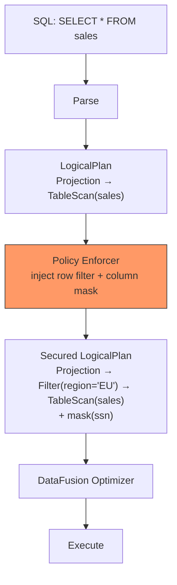

# Security & Policy

SQE enforces fine-grained security through **LogicalPlan rewriting**, injecting row filters and column masks into the query plan before DataFusion's optimizer runs.

> **Status:** The plan-rewriting policy enforcer is implemented and pluggable, and it is **off by default**. The default policy engine is `passthrough` (`PassthroughEnforcer`), which returns plans unmodified, so enforcement is opt-in. The one enforcement backend is Apache Ranger, with an in-memory store for dev and tests. A default open-source deployment runs without any of this. See [GRANT and REVOKE](../sql-reference/grant-revoke.md) for the SQL surface and the Chameleon / SBP note.

## Design Principle

Security enforcement happens at the **logical plan level**, not at the data level:



This approach means:
- **Row filters** are transparent. The user doesn't know they exist
- **Column masks** block predicate pushdown on raw values. You can't `WHERE ssn = '123-45-6789'` to probe masked data
- **Denied columns** are invisible. They don't appear in `SELECT *`, not as errors
- **The optimizer can push user predicates through row filters** but not through column masks
- **A user predicate that can fail never runs on a hidden row.** The optimizer merges the row filter and the user's `WHERE` into one conjunction and may evaluate the user side on every row, so `WHERE 1 / (id - 2) = 1` could raise a division-by-zero error from a row the user cannot see. Like PostgreSQL's leakproof rule, only predicates that cannot fail (comparisons, `IN`, `BETWEEN`, `LIKE` with a constant pattern, boolean logic, lossless casts) pass through freely. When a query holds anything else (arithmetic, functions, a cast that can fail), each row-filtered table is read through `CASE WHEN <row filter> THEN col END`, so a hidden row is all `NULL` to the user's expressions. Those tables then lose scan pruning on the user's predicates for that query

## Policy Enforcer Trait

```rust
#[async_trait]
pub trait PolicyEnforcer: Send + Sync {
    async fn evaluate(
        &self,
        user: &SessionUser,
        plan: LogicalPlan,
    ) -> Result<LogicalPlan>;
}
```

Implementations:
- **PassthroughEnforcer**: returns plan unchanged (default; enforcement opt-in)
- **Ranger**: reads row-filter and column-mask policies from Apache Ranger and feeds the plan rewriter (shipped, wired)
- **InMemory**: grants stored in a hash map for dev and tests (shipped, wired)

The Ranger enforcer reads the same `hive` service-def that Apache Spark reads through its Kyuubi authorization plugin, so one policy written once in Ranger enforces byte-identically in SQE and in Spark. See [Fine-grained access control](../features/fine-grained-access-control.md) for the how-to and [Spark / Ranger Parity](../design-notes/sqe-spark-ranger-parity.md) for the validated result.

## SQL Extensions

```sql
-- Grant row filter
GRANT SELECT ON sales TO ROLE analyst
  ROWS WHERE region = 'EU';

-- Grant column mask
GRANT SELECT ON customers TO ROLE support
  MASKED WITH (ssn AS '***-**-' || RIGHT(ssn, 4));

-- View effective grants
SHOW EFFECTIVE GRANTS FOR USER "alice";

-- View grants
SHOW GRANTS ON sales;
```

## No Information Leakage

Following the **PostgreSQL RLS model**:

| Scenario | Behavior |
|---|---|
| User queries a denied column | Column is invisible in `SELECT *`, error on explicit reference |
| User queries filtered rows | Rows silently excluded, no indication they exist |
| User applies predicate on masked column | Predicate evaluated on masked value, not raw value |
| User runs `EXPLAIN` | Shows secured plan (filters visible, mask functions visible) |
| User runs `SHOW TABLES` | Only shows tables the user has access to (Polaris enforced) |

## Runtime Security Controls

SQE includes several runtime security mechanisms that are active by default or can be enabled via configuration.

### Rate Limiting

Throttles query submission to prevent abuse or runaway clients. Uses a token-bucket algorithm (via the `governor` crate).

```toml
[rate_limit]
enabled = true
per_user_queries_per_minute = 60
global_queries_per_minute = 1000
```

When a limit is exceeded, the client receives a `RESOURCE_EXHAUSTED` Flight error. Rate limiting is disabled by default.

### Query Timeouts

Every query is subject to an execution timeout. If the query exceeds the limit, it is cancelled and the client receives an error.

```toml
[query]
timeout_secs = 300              # Default: 5 minutes

[query.role_overrides]
admin = 3600                    # Admins get 1 hour
analyst = 600                   # Analysts get 10 minutes
```

Role overrides allow different timeout limits per role. The user's longest-matching role timeout wins.

### Session Lifecycle

Sessions have both idle and absolute timeouts. A background sweeper runs every 60 seconds to clean up expired sessions.

```toml
[session]
idle_timeout_secs = 900         # 15 min idle timeout
absolute_timeout_secs = 28800   # 8 hour hard cap
```

- **Idle timeout**: sessions with no query activity for this long are expired
- **Absolute timeout**: sessions older than this are expired regardless of activity

### Query Cancellation

SQE supports Arrow Flight's native cancellation mechanism. When a client cancels a query (or disconnects), the `CancellationToken` is triggered and propagated to workers, stopping execution promptly.

### Error Sanitization

In production mode (`debug = false`, the default), error messages returned to clients are sanitized:
- Internal details (stack traces, file paths, internal error types) are stripped
- Clients receive a short error message and a request ID for correlation
- Full details are logged server-side for debugging

Enable `debug = true` during development to see full error details:

```toml
[coordinator]
debug = true
```


### Worker Trust: Signed Scan Tickets

In distributed mode, the coordinator mints signed scan tickets that workers execute. SQE uses a two-key model to prevent a compromised worker from forging or replaying tickets:

1. **Coordinator key:** Ed25519 private key on the coordinator only (`[coordinator] ticket_signing_key_file`). Signs every ticket. Never shipped to workers.
2. **Worker verification key:** Ed25519 public key on every worker (`[worker] ticket_public_key`). Verifies ticket signatures. Workers also receive it via the heartbeat response from the coordinator over the authenticated channel.

Each ticket carries:
- **Audience:** the target worker's advertised URL. Workers refuse tickets for a different audience.
- **Expiry:** absolute wall-clock time (`[coordinator] ticket_ttl_secs`, default 300 seconds). Expired tickets are rejected.

Heartbeats are bound to the peer: when mTLS is off (the common case), the advertised URL's host must resolve to the TCP peer that sent the heartbeat, unless `[coordinator] allow_unverified_advertise = true` (test-only, behind a NAT/proxy). Mismatches are logged as audit events.

**Migration:** If you still have coordinators running pre-Ed25519 code alongside new workers, set `[worker] accept_hmac_tickets = true` on new workers to accept the legacy HMAC-signed tickets while you roll the coordinators. The HMAC key is the shared secret every worker holds, so the HMAC proves nothing; turn this option off as soon as all coordinators are upgraded.

Distributed compaction (`compact_file_group`) uses the same signature scheme, so a mixed-version rollout affects it too. A new coordinator with an old worker fails distributed compaction: the old worker checks the `ed25519:` tag as an HMAC and refuses it. An old coordinator with a new worker is refused unless the worker sets `accept_hmac_tickets`, which `production_mode` forbids. Queries are not affected by this change; scan tickets follow the paragraph above. During a mixed-version rollout, set `[maintenance.distribution] mode = "local"` so compaction runs on the coordinator, and restore it once every node is upgraded.

### Distributed Scan Credentials

Scan tickets carry storage credentials. The source is chosen per-query via `[coordinator] distributed_credentials`:

- **`auto` (default):** Use catalog-vended credentials (from the table's FileIO properties) when present; otherwise fall back to the static `[storage]` key pair. Issues a one-time warning when falling back. Under `production_mode`, falls back only when truly unavailable (Polaris credential vending omitted).
- **`vended`:** Strict mode. Refuse to distribute queries over tables without vended credentials. Fails the query if the table has no session token or STS credentials.
- **`static`:** Explicit single-tenant mode. Always ship the static `[storage]` key pair, never use vended credentials.
- **`worker_default`:** Workers resolve credentials from their own environment (IRSA, pod IAM role, `AWS_*` env vars). No credentials in the ticket. Requires every worker to have independent S3 access.

### TLS Encryption

Flight SQL connections can be encrypted with TLS. Optional mTLS adds client certificate verification.

```toml
[coordinator.tls]
cert_file = "/etc/sqe/server.crt"
key_file  = "/etc/sqe/server.key"
ca_file   = "/etc/sqe/ca.crt"    # Optional: mTLS
```

See [Configuration](../deployment/configuration.md#tls) for details.
