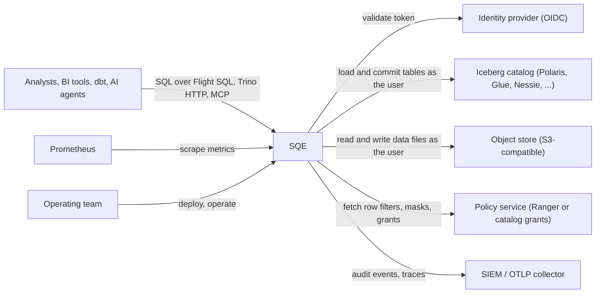
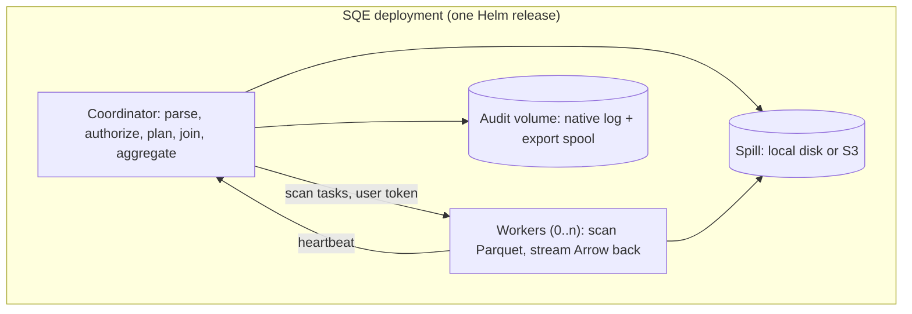

# System Context and Inventory

What an SQE deployment consists of, what it talks to, who owns each part, and how long each dependency stays supported. [System Overview](./overview.md) explains how the parts work; this page is the map and the parts list.

## Context

Who uses SQE, and which systems it depends on.

Every data access runs as the calling user: SQE forwards the user's token to the catalog and object store and holds no service account for data.

## Containers

The processes and volumes inside one deployment.

The coordinator is a single replica; workers are stateless and scale out. Nothing else in the deployment holds state.

## Runtime inventory

| Component | Kind | Owner | State it holds | Configured by |
|---|---|---|---|---|
| Coordinator | Deployment, 1 replica | Operating team, running the SQE image | Sessions (memory, or a file when `persistence = "file"`) | `sqe.toml` via the chart ConfigMap |
| Workers | Deployment, 0..n replicas | Operating team | None | Same ConfigMap |
| Audit volume | PersistentVolumeClaim | Operating team | Audit log and export spool | `audit.persistence` |
| Container image | `sqe` on the registry; releases tagged `vX.Y.Z` and `:stable` | SQE maintainers | None | Chart `image` |
| Source code | Canonical repository with CI, plus the public mirror `github.com/schubergphilis/sqe` | SQE maintainers | History, tags | n/a |
| Identity provider | External | Operating team | Users, groups, MFA | `[auth]` |
| Iceberg catalog | External | Operating team | Table metadata | `[catalog]` |
| Object store | External | Operating team | Table data | `[storage]` |
| Policy service | External | Operating team | Row filters, masks, grants | `[policy]`, `[access_control]` |
| SIEM / collector | External | Operating team | Audit and trace history | `[metrics.audit_export]`, `metrics.otlp_endpoint` |

**Labels.** Every object the chart creates carries `app.kubernetes.io/name`, `app.kubernetes.io/instance` (the release), `app.kubernetes.io/version` (the SQE version), `app.kubernetes.io/component` (`coordinator` or `worker`) and `helm.sh/chart`. The chart has no value for extra labels, so add your own ownership and cost labels (team, environment, cost centre) in your deployment tooling, for example a Kustomize `commonLabels` overlay or a Helm post-renderer. With those in place the inventory in your CMDB can be built from the cluster.

## Lifecycle register

Each dependency, the version SQE pins today, and how it is kept current. Renovate proposes updates for everything pinned in this repository, and its dependency dashboard issue is the live pinned-versus-latest view: every dependency with a newer release is listed there with its pending or blocked update. Read the "latest" column from that issue rather than from this page, which would go stale.

| Dependency | Pinned version | Support model | How SQE tracks it |
|---|---|---|---|
| Rust toolchain | 1.98.1 (`rust-toolchain.toml`) | Only the latest stable gets fixes | Bumped with each stable release |
| Apache DataFusion | 55 | Latest release only, no LTS | Major upgrades are planned work; minors via Renovate |
| Apache Arrow / Parquet (Rust) | 59 | Latest release only | Moves with DataFusion |
| iceberg-rust | Vendored: apache `main` plus the RisingWave write stack | Upstream `main`, no releases used | Weekly advisory watch on the vendored crates; periodic re-vendor |
| Runtime image base | `cgr.dev/chainguard/glibc-dynamic`, digest-pinned | Rolling, rebuilt daily upstream | Renovate bumps the digest; the image scan blocks high findings |
| Helm chart | apiVersion v2, chart version = SQE version | Released with SQE | Lint and hardening check in CI |
| Kubernetes | Chart `kubeVersion: >=1.21` (policy/v1 PDB, pod `seccompProfile`) | The three newest minors are supported upstream | That is the technical floor; run an upstream-supported minor |
| Apache Polaris (quickstarts) | 1.7.0 | Latest release | Renovate |
| Apache Ranger (quickstarts) | 2.8.0 | Latest release | Renovate |
| Keycloak (quickstarts) | 26.7.0 | Latest release | Renovate |
| PostgreSQL (quickstarts, test stack) | 17 | Five years per major | Renovate keeps 17.x patched; a major move is a hand change, with the volume name carrying the major |

A dependency past its end of life is a finding: upgrade it, or record why it stays and until when.
