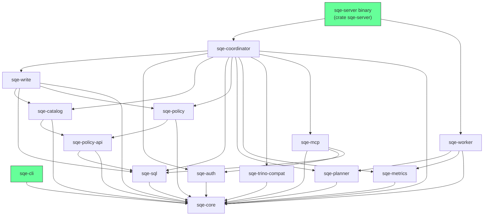

# Rust Crate Structure

SQE is organized as a Cargo workspace of focused crates. The tables below cover the core engine crates; the workspace also carries the Quack (DuckDB wire) crates, `sqe-compaction`, `sqe-spill`, `sqe-lineage`, `sqe-trino-functions` and `sqe-bench`.

## Dependency Graph

## Crate Reference

### sqe-core

Shared types used across all crates.

| Module | Contents |
|---|---|
| `config.rs` | `SqeConfig` and all sub-configs, TOML loading, env var overrides |
| `error.rs` | `SqeError` enum (Auth, Catalog, Execution, Config, NotImplemented, Internal) |
| `session.rs` | `Session` struct (id, user, tokens, expiry), `SessionUser` (username, roles) |
| `lib.rs` | `VERSION` constant |

### sqe-auth

Keycloak OIDC authentication.

| Module | Contents |
|---|---|
| `authenticator.rs` | `Authenticator`: ROPC grant, token refresh, background refresh task |
| `keycloak.rs` | `KeycloakClient`: HTTP calls to Keycloak token endpoint, role extraction |
| `token_cache.rs` | `TokenCache`: DashMap of session to cached tokens, expiry tracking |

### sqe-catalog

Iceberg REST catalog client (wraps iceberg-rust).

| Module | Contents |
|---|---|
| `rest_catalog.rs` | `SessionCatalog`: per-user catalog with bearer token, namespace/table ops |
| `catalog_provider.rs` | `SqeCatalogProvider`: DataFusion `CatalogProvider` bridge |
| `schema_provider.rs` | `SqeSchemaProvider`: DataFusion `SchemaProvider` for Iceberg namespaces |
| `table_provider.rs` | Iceberg to DataFusion `TableProvider` |
| `credential_vending.rs` | Extract S3 credentials from Polaris table load response |
| `iceberg_scan.rs` | Iceberg scan configuration |
| `info_schema.rs` | Virtual `information_schema` (tables, schemata, columns) |

### sqe-sql

SQL parsing and statement classification.

| Module | Contents |
|---|---|
| `classifier.rs` | `parse_and_classify(sql)` to `StatementKind`, routes all SQL statement types |

### sqe-policy-api

The interfaces the catalog needs from the policy layer, and nothing else, so
the two crates compile side by side instead of the catalog waiting for the
policy engine. `sqe-policy` re-exports all of it under its old paths.

| Module | Contents |
|---|---|
| `lib.rs` | `PolicyStore` trait; `ResolvedPolicy`, `MaskType`, `TagMaskSpec`, `MaskPolicyInfo` |
| `grants.rs` | `GrantBackend` trait; `GrantStatement`, `RevokeStatement`, `Grantee`, `GrantFilter`, `AccessCheck`, `GrantEntry`, `AccessCheckResult` |
| `hive_catalogs.rs` | `HiveCatalogs`: the live set of catalogs holding Hive external tables |

### sqe-policy

Policy enforcement framework (pluggable backend).

| Module | Contents |
|---|---|
| `lib.rs` | `PolicyEnforcer` trait, `PassthroughEnforcer` (default no-op); re-exports of `sqe-policy-api` |
| `plan_rewriter.rs` | `PolicyPlanRewriter`: row filters, column masks and restrictions injected above `TableScan` |
| `ranger_store.rs`, `policy_store.rs` | `RangerStore` and `InMemoryPolicyStore` implementations of `PolicyStore` |
| `grants/` | `PolarisGrantBackend`, Ranger grant backend, profile-based grants |

### sqe-planner

Distributed query planning.

| Module | Contents |
|---|---|
| `scan_task.rs` | `ScanTask`: serializable message from coordinator to worker |
| `splitter.rs` | `split_files()`: divide data files across workers |

### sqe-write

The write path, split out of the coordinator so it compiles in parallel with
the distribution and maintenance code. It depends on the shared tier only;
the coordinator reaches back in through the `CatalogDiscovery` trait and
re-exports every module here under its old `sqe_coordinator::` path.

| Module | Contents |
|---|---|
| `write_handler.rs` | `WriteHandler`: CTAS, INSERT, INSERT OVERWRITE, UPDATE, DELETE, MERGE; schema mapping and Iceberg commits |
| `writer.rs` | Parquet data and position-delete file writing, upload tracking, fanout caps |
| `merge_sql.rs`, `merge_target_provider.rs` | MERGE clause classification and SQL rewriting |
| `puffin_carry.rs` | Puffin statistics carry-forward across commits |
| `hive_write.rs` | Hive external-table CTAS and INSERT |
| `ident.rs`, `commit.rs` | Identifier folding and resolution; commit-with-retry and conflict classification |
| `test_support/sqlite_rig.rs` | In-process SQLite-backed write rig (feature `test-sqlite`) |

### sqe-server

The shipped binary, `sqe-server --mode coordinator|worker`. One file of wiring: config load and validation, the auth chain, the session manager, the Flight SQL, Trino, MCP, Quack and health listeners, the maintenance scheduler, and the embedded worker. It depends on both `sqe-coordinator` and `sqe-worker`; the two libraries do not depend on each other, so a worker-only change no longer rebuilds the coordinator and its integration-test binaries.

### sqe-coordinator

The coordinator: SQL routing, session management, maintenance, distribution.

| Module | Contents |
|---|---|
| `flight_sql.rs` | `SqeFlightSqlService`: Arrow Flight SQL server (735 lines) |
| `query_handler.rs` | `QueryHandler`: central query routing and execution (596 lines) |
| `session_manager.rs` | `SessionManager`: session lifecycle, token refresh integration |
| `worker_registry.rs` | `WorkerRegistry`: worker discovery, health checking |
| `catalog_ops.rs` | DDL operations (DROP TABLE, CREATE/DROP SCHEMA, ALTER TABLE) |
| `maintenance*.rs` | Maintenance procedures, scheduler, ledger and lease |
| `distributed_scan.rs` | Distributed scan coordination |
| `mcp_server.rs` | MCP wiring: router mount, dedicated-listener mode, and the executor that runs tool SQL through `QueryHandler` under the existing auth and query rate limiters |
| `mode.rs` | `Mode` enum, `resolve_mode()` for sqe-server |
| `bin/sqe_server.rs` | Unified server binary entry point |

### sqe-worker

Stateless scan executor.

| Module | Contents |
|---|---|
| `executor.rs` | `execute_scan(ScanTask)`: read Parquet from S3, return Arrow batches |
| `flight_service.rs` | `WorkerFlightService`: Flight server for receiving scan tasks |

### sqe-cli

Interactive SQL client.

| Module | Contents |
|---|---|
| `main.rs` | CLI argument parsing (clap), REPL loop, auth flow |
| `client.rs` | `SqlClient` trait, `QueryResult` type |
| `flight.rs` | `FlightClient`: Flight SQL client with handshake and token auth |
| `http.rs` | `HttpClient`: Trino HTTP protocol client |
| `display.rs` | Output formatting: ASCII table, CSV, JSON |

### sqe-metrics-core

The registry types and trace-context propagation, and nothing heavier. The policy, catalog, compaction and write crates depend on this crate (under the dependency name `sqe-metrics`, so their sources read `sqe_metrics::MetricsRegistry`), which keeps the OTLP exporters, the OpenTelemetry SDK, the tracing subscriber and the axum server out of their builds.

| Module | Contents |
|---|---|
| `lib.rs` | `MetricsRegistry`, `WorkerMetricsRegistry`, `HasRegistry`: Prometheus counters, histograms, gauges |
| `propagation.rs` (feature `propagation`) | W3C trace context over tonic metadata and HTTP headers, correlation ids |

### sqe-metrics

Observability stack; re-exports everything in `sqe-metrics-core`.

| Module | Contents |
|---|---|
| `server.rs` | Prometheus HTTP `/metrics` endpoint (axum) |
| `audit/` | `AuditLogger`: OCSF and JSONL audit pipeline, sinks, redaction |
| `otel.rs` | OpenTelemetry init (traces, metrics, logs via OTLP/gRPC) |

### sqe-trino-protocol

Trino wire types and the shared clients. serde only by default; the client, Arrow and Flight surfaces are opt-in features so a consumer links what it uses and nothing more.

| Module | Contents |
|---|---|
| `types.rs` | `/v1/statement` JSON types and type-signature helpers |
| `client.rs` (feature `client`) | `TrinoHttpClient`: auth, same-origin `nextUri`, bounded pagination, cancel on drop |
| `decode.rs` (feature `arrow`) | Trino JSON pages to Arrow `RecordBatch` with faithful types |
| `encode.rs` (feature `arrow`) | Arrow cells to Trino JSON values; the one value encoding for the Trino server and the MCP endpoint |
| `flight.rs` (feature `flight`) | `FlightSqlClient` over `FlightSqlServiceClient` |

### sqe-trino-compat

Trino wire protocol compatibility layer (the server side).

| Module | Contents |
|---|---|
| `server.rs` | Trino HTTP server (`/v1/statement` endpoint) |
| `protocol.rs` | RecordBatch to Trino JSON response serialization |
| `types.rs` | Arrow to Trino type mapping; re-exports the value encoder from `sqe-trino-protocol` |

### sqe-mcp

Model Context Protocol endpoint. An OAuth resource server, not an authorization server: it validates the caller's bearer through `sqe-auth` and hands the identity to the coordinator's session layer.

| Concern | Contents |
|---|---|
| Transport | Streamable HTTP `/mcp` route (axum), JSON-RPC dispatch, `initialize` / `tools/list` / `tools/call` |
| OAuth | RFC 9728 protected-resource metadata routes, `WWW-Authenticate` challenges, scope checks, `Origin` allow-list |
| Tools | Nine read tools plus the optional `execute_sql_change`; annotations mark read-only versus write |
| SQL gating | `sqe-sql` pre-parse plus `parse_and_classify_typed`, allow-listing query and `SHOW` kinds only |
| Bounding | `max_result_rows` / `max_response_bytes` with an explicit `truncated` flag |

Reference: [Model Context Protocol](../deployment/mcp.md).

## Key External Dependencies

| Crate | Version | Purpose |
|---|---|---|
| `datafusion` | 51 | Query engine (SQL planning, optimization, execution) |
| `arrow` / `arrow-flight` | 57 | Columnar data format and Flight SQL protocol |
| `iceberg` / `iceberg-catalog-rest` | 0.8 | Iceberg table format and REST catalog |
| `tonic` | 0.14 | gRPC framework (Flight SQL server + client) |
| `axum` | 0.8 | HTTP framework (health, metrics, Trino compat) |
| `tokio` | 1 | Async runtime |
| `sqlparser` | 0.59 | SQL parsing |
| `moka` | 0.12 | Async TTL cache (metadata caching) |
| `clap` | 4 | CLI argument parsing |
| `tracing` | 0.1 | Structured logging |
| `opentelemetry` | 0.31 | Distributed tracing and metrics |
