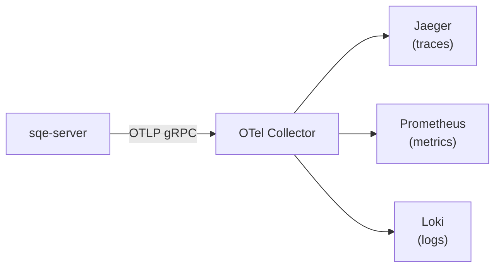

# Observability

SQE provides full observability through Prometheus metrics, OpenTelemetry traces/logs, and structured audit logging.

## Metrics (Prometheus)

Available at `http://coordinator:9090/metrics` in Prometheus text format.

| Metric | Type | Labels | Description |
|---|---|---|---|
| `sqe_query_count_total` | Counter | `status`, `statement_type` | Total queries by status and type |
| `sqe_query_duration_seconds` | Histogram | `statement_type` | Query duration distribution |
| `sqe_rows_returned_total` | Counter | — | Cumulative rows returned |
| `sqe_active_queries` | Gauge | none | Queries that have not reached a terminal state |
| `sqe_active_sessions` | Gauge | — | Current active sessions |
| `sqe_transactions_open` | Gauge | none | Explicit transactions open on this coordinator |
| `sqe_transactions_ended_total` | Counter | `outcome` | Ended transactions: `committed`, `rolled_back`, `conflict`, `idle_timeout`, `lifetime`, `session_ended`, `shutdown` |
| `sqe_transaction_duration_seconds` | Histogram | none | Seconds from a transaction's first statement to its end |
| `sqe_transaction_not_found_total` | Counter | none | Statements refused because their transaction belongs to another coordinator or to this one before a restart |
| `sqe_transaction_branch_drop_failures_total` | Counter | none | Transaction branches a rollback or abort could not drop |
| `sqe_healthy_workers` | Gauge | — | Workers passing health checks |
| `sqe_scan_files_total` | Counter | `outcome` | Iceberg files planned, read, or pruned |
| `sqe_scan_bytes_total` | Counter | `stage` | Iceberg bytes planned and read |
| `sqe_scan_rows_total` | Counter | `stage` | Iceberg rows before filters, decoded, and returned by scans |
| `sqe_scan_row_groups_pruned_total` | Counter | none | Parquet row groups skipped by bloom pruning |
| `sqe_s3_requests_total` | Counter | `operation`, `status` | S3 request outcomes |
| `sqe_s3_bytes_read_total` | Counter | none | Bytes read from S3, including local Iceberg scans |
| `sqe_s3_bytes_written_total` | Counter | none | Bytes written to S3 |
| `sqe_coordinator_memory_used_bytes` | Gauge | none | DataFusion coordinator memory in use |
| `sqe_coordinator_memory_limit_bytes` | Gauge | none | Configured coordinator memory limit |
| `sqe_coordinator_memory_pressure` | Gauge | none | Memory pressure level from 0 to 3 |

Histogram buckets: 10ms, 25ms, 50ms, 100ms, 250ms, 500ms, 1s, 2.5s, 5s, 10s, 30s, 60s.

Statement types: `query`, `ctas`, `insert`, `merge`, `delete`, `drop`, `create_view`, `create_schema`, `show_catalogs`, `show_schemas`, `show_tables`, `policy`, `utility`.

### Example Queries (PromQL)

```promql
# Query rate (queries per second)
rate(sqe_query_count_total[5m])

# Error rate
rate(sqe_query_count_total{status="error"}[5m])

# P99 query duration
histogram_quantile(0.99, rate(sqe_query_duration_seconds_bucket[5m]))

# Active sessions
sqe_active_sessions
```

### Distributed scan tickets

Every fragment of a distributed scan travels to its worker as one `ScanTask` ticket: file list, projection, predicate, storage settings and credentials. The coordinator encodes a ticket per dispatch attempt, and when dynamic join filters are in play it first decodes each partition's predicate, ANDs in the filter snapshots and serializes it again. Three histograms measure that cost.

| Metric | Type | Labels | Description |
|---|---|---|---|
| `sqe_scan_ticket_bytes` | Histogram | none | Size of each ticket sent to a worker, after a predicate that would break the message ceiling is dropped. One sample per dispatch attempt, so retries count again |
| `sqe_scan_ticket_encode_seconds` | Histogram | none | Coordinator time to serialize one ticket, including the re-encode without the predicate |
| `sqe_scan_ticket_dynamic_filter_seconds` | Histogram | none | Coordinator time per partition to AND dynamic filters into the ticket predicate and serialize it again. The bounded wait for the join builds is excluded |
| `sqe_scheduler_task_count` | Histogram | none | Tickets planned per distributed Iceberg scan |

Byte buckets run from 1 KiB to 16 MiB, the default gRPC message ceiling. Time buckets run from 10 microseconds to 1 second. The `_sum` series are CPU time spent across concurrent partitions, not wall time, so compare them with query time as a share of work, not as latency.

```promql
# Ticket size p50 and p99 over a run
histogram_quantile(0.5, sum(increase(sqe_scan_ticket_bytes_bucket[1h])) by (le))
histogram_quantile(0.99, sum(increase(sqe_scan_ticket_bytes_bucket[1h])) by (le))

# Ticket work as a share of query time
(sum(increase(sqe_scan_ticket_encode_seconds_sum[1h]))
  + sum(increase(sqe_scan_ticket_dynamic_filter_seconds_sum[1h])))
/ sum(increase(sqe_query_duration_seconds_sum[1h]))

# Encodes per planned ticket (above 1 means retries)
increase(sqe_scan_ticket_encode_seconds_count[1h])
/ increase(sqe_scheduler_task_count_sum[1h])
```

### Local observability stack

For a self-contained metrics view alongside the test stack, SQE ships a Docker Compose overlay using VictoriaMetrics (Prometheus-compatible, around 30 MB RAM) and Grafana:

```bash
docker compose -f docker-compose.test.yml -f docker-compose.observability.yml up -d
open http://localhost:13000    # Grafana, admin / admin
```

The overlay auto-scrapes the single-node coordinator (`localhost:19090`), the distributed coordinator (`localhost:29090`), and workers (`localhost:29091-29094`). A pre-built dashboard lives at `deploy/observability/sqe-benchmark-dashboard.json` and is auto-provisioned by the overlay. To import it manually, copy the JSON into your Grafana instance and point it at a Prometheus or VictoriaMetrics data source.

## Health Endpoints

Available on port 9091 (metrics port + 1) for both coordinator and workers.

### Kubernetes Probes

| Endpoint | Purpose | Response |
|---|---|---|
| `GET /healthz` | Liveness probe | `200 ok`; `503 mcp listener down` once a dedicated `/mcp` listener's serve task has ended |
| `GET /readyz` | Readiness probe | `200` when ready, `503` during init or when a check fails; `checks.mcp` is `ok` or `down` when MCP has its own port |

A dedicated MCP listener (`[mcp] port` > 0) is supervised: if its accept loop
ends for any reason, including a panic, the coordinator logs at ERROR, clears
the liveness flag both probes read, flips readiness so a load balancer stops
routing, and exits with status 70 so the supervisor restarts the process. A
process that stays up with a closed `/mcp` is the one failure no external
health check can see, so `sqe-server` does not stay up in that state. With
`port = 0` the MCP routes share this listener and answering `/healthz` already
proves them reachable.

### Cluster Status (Ballista/DataFusion-style)

`GET /api/v1/status` is open (no auth) and returns only the lifecycle state and
role, for probes and load balancers:

```json
{"status": "ACTIVE", "node": {"role": "coordinator"}}
```

`GET /api/v1/status/detail` returns the full snapshot of the node and cluster.
It is registered on a coordinator only and needs `Authorization: Bearer <token>`
for an identity holding an admin role (401 without a valid token, 403 for a
non-admin one):

```json
{
  "status": "ACTIVE",
  "node": {
    "role": "coordinator",
    "version": "0.48.1",
    "gitSha": "9525cbb8d1e2",
    "buildProfile": "release",
    "datafusionVersion": "55.1.0",
    "uptimeSeconds": 3600
  },
  "workers": {
    "total": 2,
    "healthy": 2,
    "healthyUrls": ["http://worker-0:50052", "http://worker-1:50052"]
  },
  "serving": {
    "mode": "full",
    "flightSqlPort": 50051,
    "trinoHttpPort": 8080,
    "quackPort": null,
    "mcp": {"port": 8099, "authMode": "oauth", "allowWrites": false},
    "policyEngine": "ranger",
    "catalogs": [
      {"name": "glue", "kind": "hive-glue"},
      {"name": "iceberg", "kind": "rest"}
    ]
  }
}
```

`datafusionVersion` is the version of the DataFusion library the binary was
linked against. `serving` describes what the process answers: `mode` is
`mcp-only` when every SQL front door is closed and only `/mcp` is open
(`--mcp-only`), the port fields are `null` for a disabled listener, `mcp` is
`null` when MCP is off and otherwise names the auth mode (`oauth`, `static`,
`anonymous`) and whether writes are advertised, `policyEngine` is the
`[policy] engine` value, and `catalogs` lists every attached catalog with its
kind (`rest`, `hms`, `glue`, `jdbc`, `s3tables` for Iceberg catalogs;
`hive-glue` or `hive-sidecar` for Hive roots, including `--glue-catalog`). It is
fixed at startup from the effective configuration, flags included.

On a worker, `/api/v1/status/detail` is not registered; the open
`/api/v1/status` reports `"role": "worker"`.

### Trino-Compatible Info (port 8080)

When the Trino compat layer is enabled, standard Trino info endpoints are available on the Trino HTTP port:

| Endpoint | Response |
|---|---|
| `GET /v1/info` | JSON: `nodeVersion`, `environment`, `coordinator`, `starting`, `uptime` |
| `GET /v1/info/state` | Plain text: `ACTIVE` or `STARTING` |

These endpoints are compatible with Trino JDBC drivers, DBeaver, and other Trino-aware tools for auto-detecting node state.

## OpenTelemetry

`otlp_endpoint` exports traces, metrics, and logs via OTLP/gRPC. A collector with
only a traces pipeline should use `traces_otlp_endpoint`; Prometheus scraping and
structured stdout logging then remain independent.



Configuration:
```toml
[metrics]
# Trace-only collector. Recommended when /metrics is scraped and stdout logs
# are collected separately.
traces_otlp_endpoint = "https://otel-collector:4317"
trace_sample_rate = 1.0

# Legacy all-signals endpoint. Leave empty for the trace-only setup above.
otlp_endpoint = ""
```

When the endpoint is empty (default), SQE falls back to structured JSON logs on stdout, no external dependency required.

### Trace Spans

Key spans emitted:
- `sqe.query`: full query and result-stream lifecycle
- `sqe.plan`: SQL parsing and planning
- `sqe.policy_rewrite`: policy enforcement
- `iceberg_scan`: Iceberg planning, read, decode, and filter work
- `dispatch_to_worker`: coordinator fragment dispatch
- `sqe.worker.scan`: worker scan execution
- `iceberg.rest.request`: outbound Polaris or Iceberg REST catalog request

### W3C trace and request correlation

The Trino HTTP and Flight SQL endpoints accept the standard W3C
`traceparent` and `tracestate` headers. Flight clients send the same values as
ASCII gRPC metadata. SQE extracts them before authentication or planning and
uses the configured global W3C propagator on coordinator to worker Flight calls
and outbound Iceberg REST catalog calls.

The optional `x-request-id` and `x-session-id` values are correlation metadata,
not credentials. SQE accepts only 1 to 128 characters from
`A-Z`, `a-z`, `0-9`, `.`, `_`, `:`, and `-`. Invalid values are omitted. These
headers never replace the W3C trace ID and are never used for authentication.

Correlation fields have distinct meanings:

| Field | Meaning |
|---|---|
| `trace_id` | 32-character lowercase hexadecimal W3C trace shared across services |
| `span_id` | 16-character lowercase hexadecimal identifier for one operation |
| `request_id` | BFF request correlation value, when supplied and valid |
| `session_id` | Safe caller correlation value or SQE session identifier, depending on the boundary |
| `query_id` | SQE query lifecycle identifier used for submission, polling, cancellation, and profiles |

Trino polling and cancellation are independent HTTP requests. Their spans use
their own incoming remote parent and record the original `query_id`; SQE does
not invent parent relationships between separate BFF requests. The durable
`sqe.query` span remains active while the result stream is executing.

### VictoriaLogs and VictoriaTraces investigation

Start in VictoriaLogs with the BFF request value, for example
`request_id:="req-01JABC"`. Open an SQE event and copy its `trace_id`. Search
VictoriaLogs for that exact `trace_id` to see the coordinator, policy and auth,
worker, and Polaris events. Open the same ID in VictoriaTraces to inspect the
`flight_sql.request` or `trino.*` server span, `sqe.query`, Iceberg scan,
`dispatch_to_worker`, `sqe.worker.scan`, and `iceberg.rest.request` chain. Use
`query_id` to join later Trino polling or cancellation requests to the durable
query lifecycle and to compare the trace with `EXPLAIN FULL` scan counters.

## Audit Log

SQE writes a JSONL audit log capturing every query:

```json
{
  "timestamp": "2025-03-15T10:30:00Z",
  "username": "alice",
  "session_id": "a1b2c3d4-e5f6-7890-abcd-ef1234567890",
  "query_text": "SELECT * FROM sales.orders WHERE region = 'EU'",
  "query_hash": "sha256:e3b0c44298fc1c149afb...",
  "statement_type": "query",
  "client_ip": "10.0.1.42",
  "duration_ms": 142,
  "rows_returned": 1583,
  "status": "ok"
}
```

The `query_hash` field is a SHA-256 hash of the SQL text, useful for correlating repeated queries without storing the full text. When audit logging is enabled, all fields are always present.

Configuration:
```toml
[metrics]
audit_log_path = "/var/log/sqe/audit.jsonl"
```

When the path is empty (default), audit logging is disabled (no-op).

## Structured Logging

All SQE components use `tracing` with JSON output:

```json
{
  "timestamp": "2025-03-15T10:30:00.142Z",
  "level": "INFO",
  "target": "sqe_coordinator::query_handler",
  "message": "Query executed",
  "trace_id": "0af7651916cd43dd8448eb211c80319c",
  "span_id": "00f067aa0ba902b7",
  "request_id": "req-01JABC",
  "session_id": "session-42",
  "query_id": "0190f4d5-ec1a-7b22-9f86-55a89dce7777",
  "user": "alice",
  "statement_type": "query",
  "duration_ms": 142,
  "rows": 1583
}
```

Log level controlled via `RUST_LOG` environment variable:
```bash
RUST_LOG=info             # Default
RUST_LOG=sqe=debug        # Debug SQE crates only
RUST_LOG=sqe=trace        # Everything
```

## Kubernetes Integration

The Helm chart includes optional `ServiceMonitor` for Prometheus Operator:

```yaml
serviceMonitor:
  enabled: true
  interval: 30s
  labels:
    release: prometheus
```
